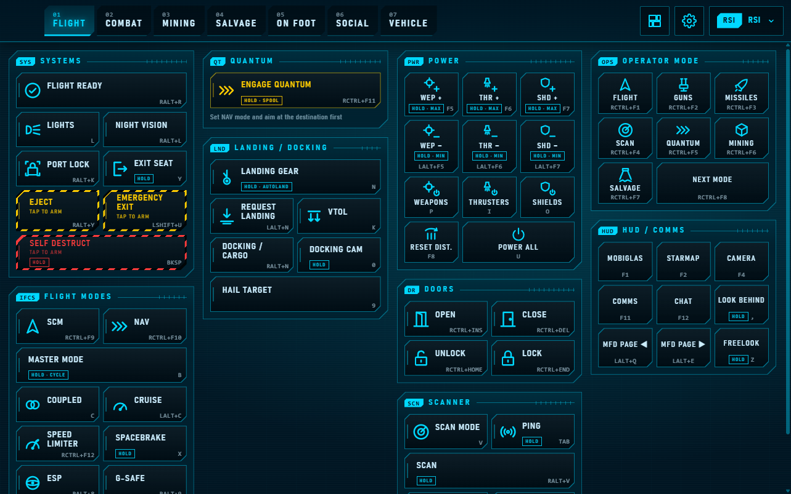
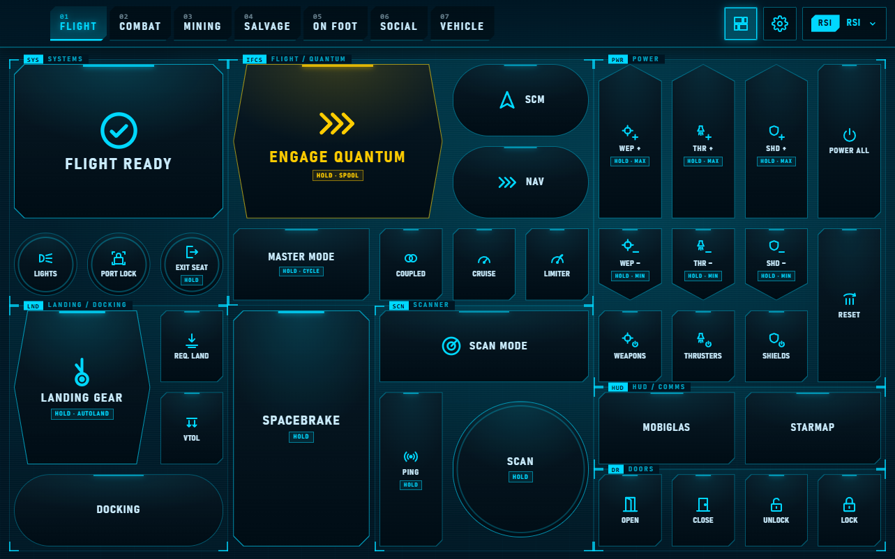
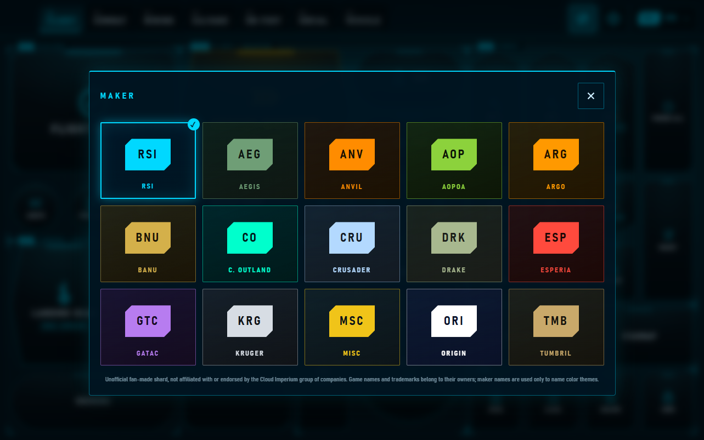

# SC MFD para LibreShard

<p align="center"><a href="README.md">English</a> · <b>Español</b></p>

Una pantalla multifunción (MFD), al estilo de una cabina, para el juego espacial SC (4.x) en tu tablet:
un shard de [LibreShard](https://github.com/libreshard/libreshard) con más de 170 acciones del juego
en siete pestañas (vuelo, combate, minería, salvamento, a pie, social y vehículos), con el estilo de
las pantallas de la cabina.

> Proyecto de fans no oficial, sin afiliación ni respaldo del grupo de empresas Cloud Imperium.
> No contiene material gráfico del juego: ver [NOTICE](NOTICE).

<p align="center">
  <br>
  
  
</p>

## Características

- **Siete pestañas** con las teclas por defecto del juego: reparto de energía, escudos,
  contramedidas, fijación de objetivos, quantum, aterrizaje, puertas, cabezales de minería y
  salvamento, equipo, emotes y más.
- **Modo minimalista:** una pantalla por pestaña con las acciones principales en botones grandes, sin
  desplazarse.
- **Mantener y proteger:** las acciones que el juego distingue entre tocar y mantener (aterrizaje
  automático, energía al máximo, señuelos de pánico) se mantienen mientras el dedo está encima. Las
  peligrosas (autodestrucción, eyección, soltar la carga) necesitan un primer toque para armarse.
- **Tu distribución:** reordena las secciones de cada pestaña arrastrándolas, y elige tamaño de texto y
  tema de color. Todo se guarda en la tablet.
- **Solo en el juego:** LibreShard solo pulsa sus teclas mientras el juego es la app en primer plano.
- Inglés y español.

## Requisitos

- [LibreShard](https://github.com/libreshard/libreshard) 0.1.0 o posterior, en Windows.
- El juego (4.x) con la **asignación de teclas por defecto**. Los botones pulsan las teclas por
  defecto del juego; si cambiaste las tuyas, edita `layout.js` (ver [Personalizar](#personalizar)).

## Instalación

1. Descarga `sc-mfd-<versión>.libreshard` desde
   [Releases](https://github.com/libreshard/libreshard-sc-mfd/releases).
2. Haz doble clic en él, o arrástralo a la ventana de LibreShard en tu PC.
3. LibreShard muestra una revisión con todas las teclas que el shard puede pulsar (173). Revísala e
   instala.

### Asignar las acciones que no tienen tecla por defecto

Algunas acciones (puertas, escudos por cara, modos de operador, emotes…) no tienen tecla por defecto
en el juego. El shard pulsa combinaciones libres para ellas (con **Ctrl derecho** o **Alt derecho**), y
el perfil de controles incluido, **LibreShard MFD**, las asigna en el juego:

1. En LibreShard, abre la carpeta del shard (**Shards → Abrir carpeta** en su tarjeta) y copia
   `LibreShard_MFD.xml` a `StarCitizen\LIVE\user\client\0\controls\mappings`.
2. En el juego: **Opciones → Asignación de teclas → Perfiles de control → LibreShard MFD**.

El perfil solo añade esas asignaciones; las demás acciones conservan su tecla por defecto. Los ajustes
del shard (el engranaje de su barra superior) repiten estos pasos.

## Personalizar

Todo está en archivos de texto; no hace falta compilar nada para cambiar botones:

- `layout.js`: todas las pantallas y botones (etiqueta, tecla, acción del juego, icono, mantener/proteger).
- `compact.js`: la cuadrícula del modo minimalista, hecha con botones de `layout.js`.
- `tools/icons.js`: el juego de iconos.

Después de editar, ejecuta (Node.js 22 o posterior):

```bash
node tools/build-profile.js   # regenera LibreShard_MFD.xml y las teclas del manifest
node tools/check-compact.js   # comprueba el modo minimalista (con --map dibuja sus cuadrículas)
node tools/build-icons.js     # regenera icons.css si cambiaste tools/icons.js
```

Para probar los cambios en vivo, usa **Shards → Cargar en desarrollo…** en LibreShard: la tablet
recarga el shard cada vez que guardas. Si añades teclas, LibreShard te pedirá aprobarlas otra vez.

## Contribuir

Se aceptan issues y pull requests. Los commits deben llevar la firma del
[Developer Certificate of Origin](https://developercertificate.org/) (`git commit -s`). No añadas
material del juego ni de su fan kit oficial: sus condiciones no permiten redistribuirlo.

## Licencia

[Licencia Apache 2.0](LICENSE). Ver [NOTICE](NOTICE) para las notas sobre marcas y el proyecto de fans.
