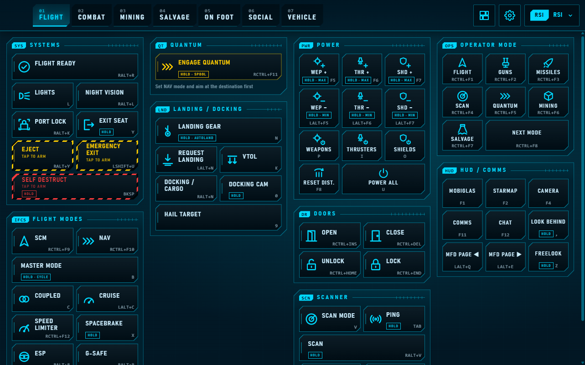
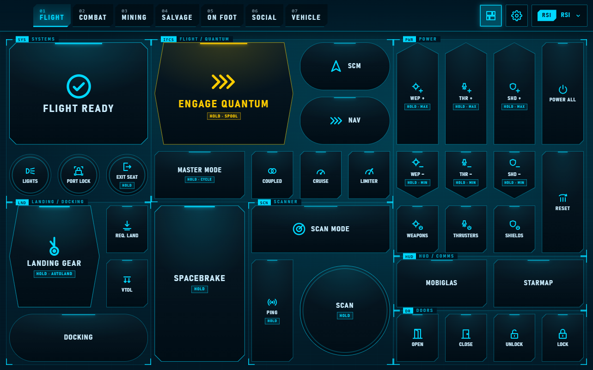
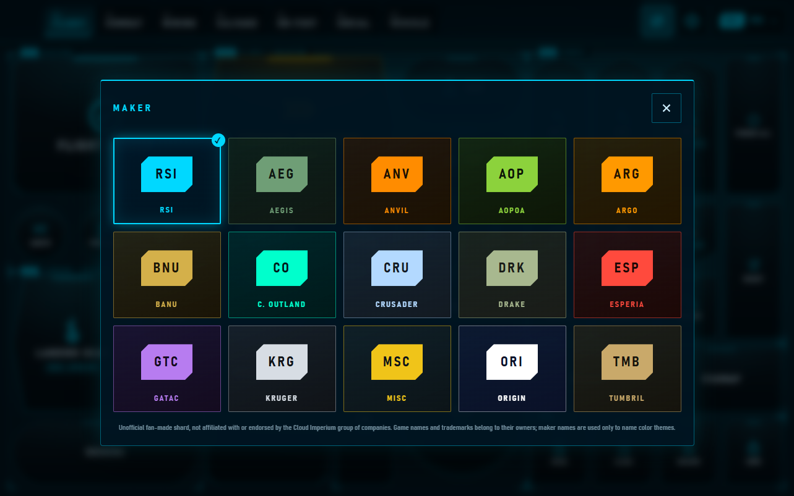

# SC MFD for LibreShard

<p align="center"><b>English</b> · <a href="README.es.md">Español</a></p>

A cockpit-style multi-function display for the space game SC (4.x) on your tablet: a
[LibreShard](https://github.com/libreshard/libreshard) shard with 170+ game actions across seven tabs
(flight, combat, mining, salvage, on foot, social and vehicles), styled after the game's cockpit
screens.

> Unofficial fan project, not affiliated with or endorsed by the Cloud Imperium group of companies.
> It contains no game artwork: see [NOTICE](NOTICE).

<p align="center">
  <br>
  
  
</p>

## Features

- **Seven tabs** with the game's default keys: power distribution, shields, countermeasures, targeting,
  quantum, landing, doors, mining and salvage heads, loadout, emotes and more.
- **Minimal mode:** one screen per tab with the main actions in big buttons, no scrolling.
- **Hold and guard:** actions the game tells apart by tap or hold (auto-land, max power, panic
  decoy) are held while your finger stays on them. Dangerous ones (self destruct, eject, jettison
  cargo) need a first tap to arm.
- **Your layout:** reorder each tab's sections by dragging them, pick a text size and a color theme.
  Everything is saved on the tablet.
- **Only in the game:** LibreShard only presses its keys while the game is the app in front.
- English and Spanish.

## Requirements

- [LibreShard](https://github.com/libreshard/libreshard) 0.1.0 or newer, on Windows.
- The game (4.x) with its **default keybindings**. The buttons press the game's default keys; if
  you changed yours, edit `layout.js` (see [Customizing](#customizing)).

## Install

1. Download `sc-mfd-<version>.libreshard` from
   [Releases](https://github.com/libreshard/libreshard-sc-mfd/releases).
2. Double-click it, or drag it onto the LibreShard window on your PC.
3. LibreShard shows a review with every key the shard may press (173). Check it and install.

### Bind the actions that have no default key

Some actions (doors, shields by face, operator modes, emotes…) have no default key in the game. The
shard presses free combos for them (with **Right Ctrl** or **Right Alt**), and the included
**LibreShard MFD** control profile binds them in the game:

1. In LibreShard, open the shard's folder (**Shards → Open folder** on its card) and copy
   `LibreShard_MFD.xml` to `StarCitizen\LIVE\user\client\0\controls\mappings`.
2. In the game: **Options → Keybindings → Control Profiles → LibreShard MFD**.

The profile only adds those bindings; every other action keeps its default key. The shard's settings
(the gear in its top bar) repeat these steps.

## Customizing

Everything lives in plain files; no build step is needed to change buttons:

- `layout.js`: every screen and button (label, key, game action, icon, hold/guard).
- `compact.js`: the minimal mode's grid, built from buttons in `layout.js`.
- `tools/icons.js`: the icon set.

After editing, run (Node.js 22 or newer):

```bash
node tools/build-profile.js   # regenerates LibreShard_MFD.xml and the manifest's keys
node tools/check-compact.js   # checks the minimal mode (add --map to draw its grids)
node tools/build-icons.js     # rebuilds icons.css after changing tools/icons.js
```

To try your changes live, use **Shards → Load in development…** in LibreShard: the tablet reloads
on every save. Adding keys makes LibreShard ask you to approve them again.

## Contributing

Issues and pull requests are welcome. Commits must be signed off (`git commit -s`, the
[Developer Certificate of Origin](https://developercertificate.org/)). Don't add any material from
the game or its official fan kit: its terms don't allow redistributing it.

## License

[Apache License 2.0](LICENSE). See [NOTICE](NOTICE) for the trademark and fan-project notes.
